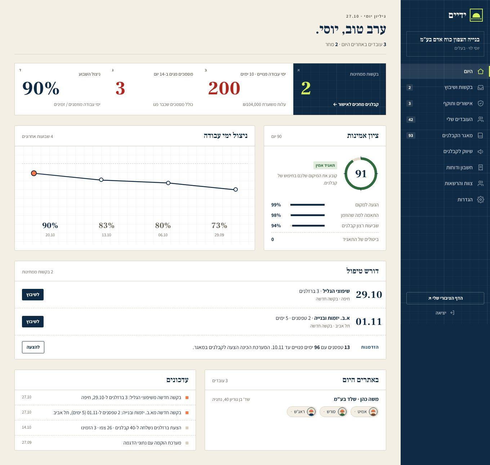

# ידיים · Yadaim

מערכת לתאגידי כוח אדם זר בבנייה ולקבלנים:
- **התאגיד** מנהל את העובדים ואת תוקף האישורים שלהם, ומשווק ימים פנויים למאגר הקבלנים שלו.
- **הקבלן** מזמין עובד מסוים לפי מקצוע ויום. הוא רואה מראש מי מגיע ומשלם מחיר סופי. בבוקר הוא מאשר באתר שהעובד מתאים, ומי שלא מתאים לא נכלל בתשלום.

הכסף עובר ישירות מהקבלן לתאגיד. ההכנסה שלנו היא תעריף קבוע לכל שעת עבודה של עובד שהקבלן אישר.

> Two-sided web app for Israel's licensed foreign-worker construction agencies and registered contractors. Next.js 16 (frontend + backend), Postgres (PGlite locally, Supabase in production), Google sign-in via Supabase Auth, RBAC + admin, Hebrew-only UI (RTL), mobile-first. Two interfaces only: agency and contractor (+ platform admin).



## התחלה מהירה (בלי שום הגדרה)
```bash
npm install
npm run dev     # http://localhost:3000
```
- **במוד dev אין התחברות.** נכנסים ישר ל-`/c` (קבלן), `/a` (תאגיד) או `/admin`.
- כפתור **DEV** בפינת המסך מחליף בין משתמשי הדגמה בכל התפקידים: בעלים, מנהל וצפייה.
- מסד הנתונים מוטמע (PGlite), ונתוני ההדגמה נטענים אוטומטית.

## מה במערכת
| אזור | יכולות |
|---|---|
| **קבלן** (`/c`) | חיפוש לפי מקצוע, עיר, תאריך ומשך · כרטיסי עובדים עם דירוג ואישורים · מחיר שכולל לינה והסעה · הזמנה · ציר שלבים · צ'ק-אין באתר · אישור שעות ודירוג · צוותים שמורים · צוות והרשאות |
| **תאגיד** (`/a`) | ציון אמינות וניצול · שיבוץ בקשות · אישורים ותוקף עם בקשת חידוש בוואטסאפ · **ייבוא עובדים מאקסל** · מאגר קבלנים · הצעות לקבלנים עם מעקב · חשבון ודוח הצבות · צוות והרשאות · הגדרות |
| **אדמין** (`/admin`) | אימות והשעיה של ארגונים · משתמשים ותפקידים · כניסה בתור (תמיכה) · יומן פעולות. אדמין נקבע רק ב-`ADMIN_EMAILS`, ומי שאינו אדמין מקבל 404 |
| **התחברות** | Google דרך Supabase ("כניסה כקבלן" / "כניסה כתאגיד") · דף פרטים בכניסה ראשונה · הזמנות לצוות · `ADMIN_EMAILS` |

## מסמכים
| מסמך | מה יש בו |
|---|---|
| [`docs/PLAN.md`](docs/PLAN.md) | תוכנית המוצר: בעיה, משתמשים, מודל עסקי, ממצאי מחקר, מפת דרכים, מדדים וסיכונים |
| [`docs/STATUS.md`](docs/STATUS.md) | **מה מומש ומה לא**, מגבלות ידועות, ורשימת עבודה לפי עדיפות |
| [`AGENTS.md`](AGENTS.md) | **הנחיות לאייג'נט או למפתח:** איך עובדים, כללים, הגדרת "בוצע" ואיך מוסיפים דברים |
| [`docs/LOCAL_DEV.md`](docs/LOCAL_DEV.md) | הרצה מקומית, משתמשי הדגמה, אקסל ובדיקות |
| [`docs/DEPLOY.md`](docs/DEPLOY.md) | דיפלוי: GitHub, Supabase (DB, Auth, Storage), Google OAuth, Vercel, וחלופת Docker |
| [`docs/SUPABASE.md`](docs/SUPABASE.md) | איך האינטגרציה עם Supabase בנויה: מיגרציות, משתני סביבה, אחסון קבצים, התחברות |
| [`docs/ARCHITECTURE.md`](docs/ARCHITECTURE.md) | ארכיטקטורה, מבנה קוד, מודל נתונים, התחברות ו-RBAC |
| [`docs/CONVERSATION.md`](docs/CONVERSATION.md) | הרפרנס לשיחה: מה ביקשת, איך זה פורש ומה הוחלט |
| [`docs/market-research.md`](docs/market-research.md) | מחקר השוק עם מקורות |
| [`docs/source/`](docs/source/) | הבריף המקורי (PDF ותמלול), סרטון הדמו ותיאורו לפי מסכים |
| [`docs/screenshots/`](docs/screenshots/) | צילומי מסך של כל המסכים |
| [`docs/design/`](docs/design/) | שלושת כיווני העיצוב שהוצגו. נבחר ג׳ · שרטוט |

## פקודות
```bash
npm run dev | build | start | typecheck
npm run test:e2e                     # 36 בדיקות מקצה לקצה (על שרת dev עם DB נקי)
npm run db:reset                     # איפוס ה-DB המקומי
npm run db:new -- <name>             # מיגרציה חדשה ב-supabase/migrations/
npm run db:migrate | db:status       # החלת מיגרציות / מה כבר רץ (מול DATABASE_URL אם הוגדר)
npm run db:seed [-- --force]         # נתוני הדגמה
```

## טכנולוגיה
Next.js 16 (App Router, Server Actions) · React 19 · Tailwind 4 · Postgres (PGlite / postgres.js) · Supabase Auth ו-Storage · Playwright · GitHub Actions.
